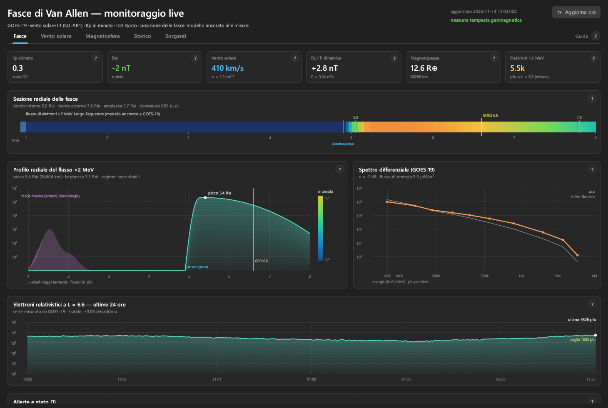
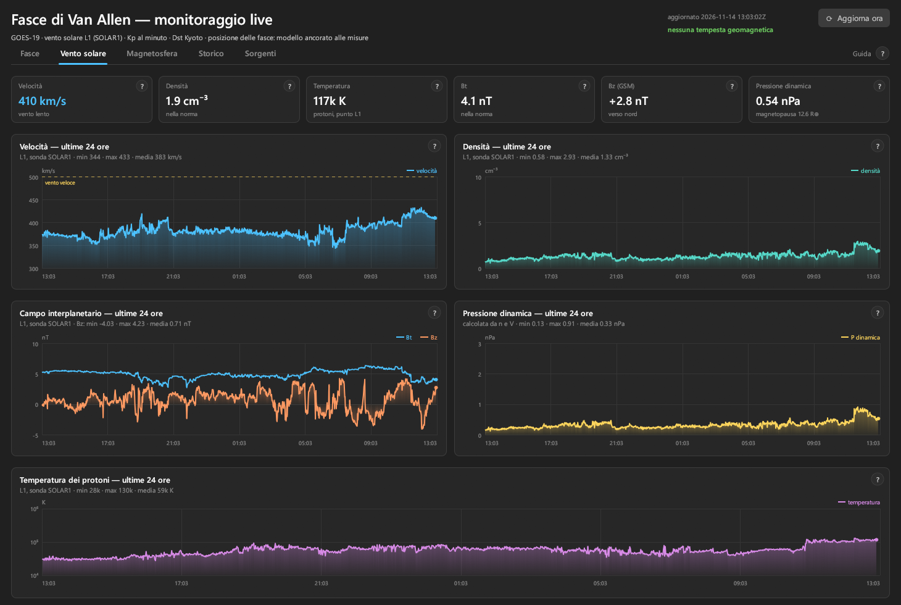
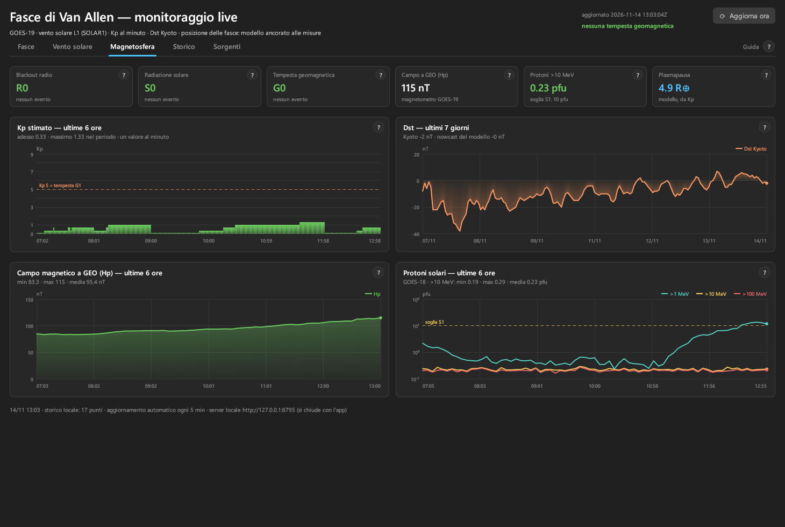
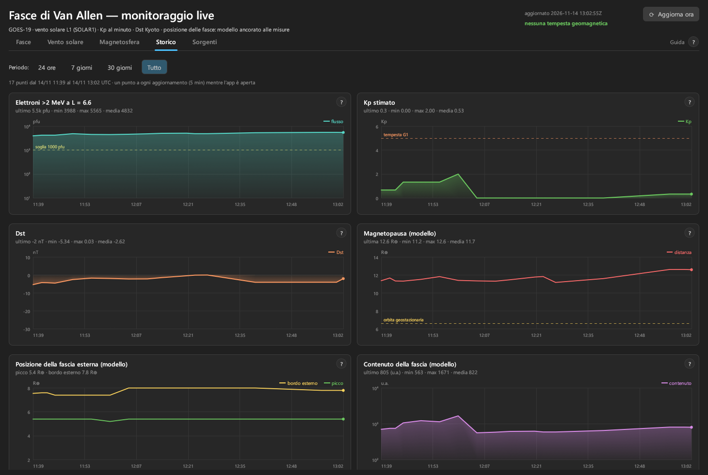
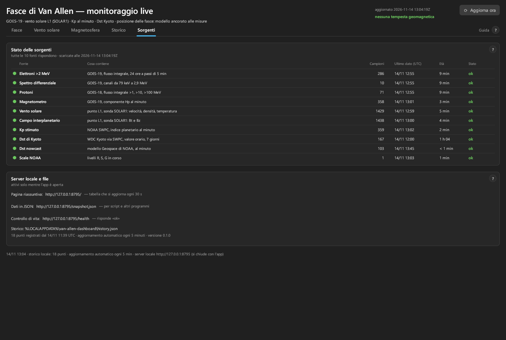

# Fasce di Van Allen — dashboard live in Rust

Dashboard desktop che tiene sotto controllo le fasce di Van Allen con dati live:
flusso di elettroni relativistici a L = 6.6, spettro differenziale, vento solare,
Kp, Dst, compressione della magnetosfera, e una stima di **dove sono e quanto sono
grandi** le fasce.



Scritta in Rust, con l'aspetto di WinUI 3: sfondo Fluent `#202020`, superfici
`#272727`, bordo `#3D3D3D`, accent `#4CC2FF`, card con angoli 8 px e tipografia
**Segoe UI / Segoe UI Semibold**. Il tema è ricostruito a mano sopra
[egui](https://github.com/emilk/egui) (vedi *Perché non il Windows App SDK*).


## Le cinque schede

| Scheda | A cosa serve |
|---|---|
| **Fasce** | quadro d'insieme: dove sono le fasce, quanto sono intense, allerte |
| **Vento solare** | ciò che arriva dal Sole, misurato a L1: velocità, densità, temperatura, Bt, Bz e pressione dinamica, con 24 ore di grafici |
| **Magnetosfera** | la risposta della Terra: scale NOAA R/S/G, Kp al minuto, Dst di 7 giorni, campo Hp a GEO, protoni solari, plasmapausa |
| **Storico** | l'andamento salvato sul PC (24 ore, 7 giorni, 30 giorni, tutto): elettroni, Kp, Dst, magnetopausa, posizione e contenuto della fascia |
| **Sorgenti** | stato di ogni fonte (ok, in ritardo, errore), numero di campioni, età dell'ultimo dato, indirizzi del server locale |

| Vento solare | Magnetosfera |
|---|---|
|  |  |

| Storico | Sorgenti |
|---|---|
|  |  |

Sui grafici di Vento solare, Magnetosfera e Storico basta passare col puntatore per
leggere ora e valore.

## Cosa mostra la scheda Fasce

| Riquadro | Contenuto |
|---|---|
| KPI | Kp stimato (scala G), Dst, vento solare (V, n), Bz e pressione dinamica, distanza della magnetopausa, flusso >2 MeV a L = 6.6 |
| Sezione radiale | striscia di intensità lungo l'equatore da 1 a 8 R⊕, con plasmapausa, posizione dei satelliti GOES e magnetopausa |
| Profilo radiale | flusso modellato in funzione di L, picco, larghezza, bordi, contenuto |
| Spettro | 10 canali differenziali GOES-19 da 79 keV a 2.9 MeV, ora contro l'inizio della finestra di 6 ore, indice spettrale γ e flusso di energia |
| Serie storica | flusso >2 MeV nelle ultime 24 ore con soglia di allerta |
| Allerte | soglie: tempesta G1–G5, Dst, elettroni relativistici, magnetopausa dentro GEO, dropout, erosione dello slot, iniezioni/crolli rapidi, protoni solari |

## Come si legge

* **Dimensione**: ampiezza = bordo esterno − bordo interno; il contenuto è l'integrale
  del profilo (unità arbitrarie), quindi confronta il numero con sé stesso nel tempo,
  non con una scala assoluta.
* **Posizione**: picco, bordi e plasmapausa in raggi terrestri (1 R⊕ = 6371 km); la
  striscia mostra dov'è tutto questo rispetto a GEO (6.6 R⊕) e alla magnetopausa.
* **Potenza**: flusso a L = 6.6 in pfu (particelle·cm⁻²·s⁻¹·sr⁻¹) e flusso di energia
  in µW/m². La soglia di allerta per gli elettroni relativistici è 1000 pfu; oltre
  10 000 pfu il riquadro diventa rosso.
* **Spettro**: γ è la pendenza media. Più è negativo, più lo spettro è ripido (pochi
  elettroni di alta energia); se si avvicina a zero lo spettro è duro, cioè ricco di
  elettroni relativistici.
* **Tempo**: 24 ore di serie con soglia tratteggiata; "in salita/in calo" è la
  pendenza in decadi all'ora.

## Dati: cosa è misurato e cosa è modello

Questa distinzione è la parte importante del progetto, ed è scritta anche a schermo.

**Misura** (sensori, nessuna interpretazione):

* GOES-19, flusso differenziale di elettroni 79 keV – 2.9 MeV e integrale >2 MeV (`services.swpc.noaa.gov/json/goes/primary/...`);
* GOES-18/19, protoni integrali 1–100 MeV e magnetometro;
* vento solare e campo interplanetario al punto L1 (RTSW: velocità, densità, temperatura, B, Bz in GSM), **solo dalla sonda operativa**: il file contiene più sonde per lo stesso minuto e mescolarle falsa la serie;
* Kp stimato al minuto e scale R/S/G NOAA;
* Dst orario (WDC Kyoto via SWPC): è il valore mostrato come «Dst».

**Modello** (calcolato qui o da altri, quindi con incertezza — non è una misura):

* Dst nowcast al minuto del modello Geospace di NOAA: mostrato a parte, accanto al dato di Kyoto, e usato come «Dst» solo se Kyoto non risponde;

* distanza della magnetopausa: `R = (10.22 + 1.29·tanh(0.184·(Bz + 8.14)))·P_dyn^(−1/6.6)` (Shue et al. 1998);
* posizione della plasmapausa: `L_pp = 5.6 − 0.46·Kp` (Carpenter & Anderson 1992), limitata a 4.9 R⊕;
* profilo radiale delle fasce esterne: gaussiana in L il cui valore a L = 6.6 è **vincolato al flusso misurato da GOES**, con bordo interno tagliato dalla plasmapausa (è ciò che genera lo slot region) e picco che si sposta verso l'interno con Kp e Dst;
* fascia interna di protoni: forma climatologica, nessuna misura live (GOES non scende sotto L ≈ 6.6, e le sonde Van Allen Probes non sono più operative dal 2019).

Quindi: **il flusso, il vento solare, Kp e Dst sono dati reali; la forma e la posizione
delle fasce sono una stima** ancorata a quei dati. Chi vuole il profilo vero serve una
missione che attraversi le fasce (Arase/ERG, o i dati d'archivio delle Van Allen Probes).

## Compilare ed eseguire

Requisiti: Windows 10/11 x64, toolchain MSVC, Rust ≥ 1.85, rete.

```powershell
git clone https://github.com/gmy77/van-allen-dashboard.git
cd van-allen-dashboard
cargo run -p vanallen --release      # oppure: .\run.ps1
```

Il primo build compila egui/eframe: pochi minuti, nessun download di SDK grafici.

### Icona sul desktop e launcher

```powershell
powershell -ExecutionPolicy Bypass -File tools\make-icon.ps1        # rigenera assets\vanallen.ico
powershell -ExecutionPolicy Bypass -File tools\create-shortcut.ps1  # collegamento sul desktop
```

Il collegamento punta a `launch.bat`, che avvia `dist\vanallen.exe` e **resta in attesa**:
quando chiudi la finestra il BAT termina anche eventuali processi rimasti appesi, così
non resta niente in esecuzione (né app, né porta occupata).

### Server locale

L'app apre da sola un server HTTP in sola lettura su `http://127.0.0.1:8787`:

| Percorso | Contenuto |
|---|---|
| `/` | pagina HTML con gli stessi numeri della dashboard, si aggiorna ogni 30 s |
| `/snapshot.json` | gli stessi dati in JSON, per script e altri programmi |
| `/health` | `ok`, per capire se l'app è viva |

Il listener vive **dentro il processo dell'app**: non esiste un servizio separato, e
chiudendo la finestra la porta si libera da sola. Ascolta solo su `127.0.0.1`, non è
raggiungibile dalla rete. Porta diversa: `set VANALLEN_PORT=9000` prima di avviare.

### Aiuti "?"

Ogni KPI e ogni riquadro, in tutte le schede, ha un pallino `?` in alto a destra: apre
la spiegazione del numero (come si legge, quali soglie contano e se è **misura** o
**modello**). Il `?` accanto a «Guida», a destra della barra delle schede, spiega come
è organizzata la dashboard. Si chiude con `Chiudi`, con `Esc` o cliccando fuori.

### Variabili d'ambiente

Tutte facoltative.

| Variabile | Effetto |
|---|---|
| `VANALLEN_PORT` | porta del server locale (predefinita 8787) |
| `VANALLEN_PRELOAD` | scarica i dati prima di aprire la finestra |
| `VANALLEN_TAB` | scheda iniziale: `fasce`, `vento`, `magnetosfera`, `storico`, `sorgenti` |
| `VANALLEN_HELP` | apre subito l'aiuto numero N |
| `VANALLEN_SHOT` | salva un PNG della finestra nel percorso dato ed esce (è così che sono fatte le immagini di questa pagina) |

### Test

```powershell
cargo test --workspace                   # fisica, parser, tempo, storico, testi di aiuto
cargo test -p vanallen-core --test live -- --ignored   # controlla i servizi reali
```

## Struttura

```
core/   vanallen-core: nessuna dipendenza grafica
  sources.rs   endpoint e parser tolleranti
  physics.rs   magnetopausa, plasmapausa, profilo delle fasce, spettro, soglie
  snapshot.rs  aggiornamento in parallelo + allerte
  history.rs   storico su %LOCALAPPDATA%\van-allen-dashboard\history.json
  time.rs      date UTC senza dipendenze
app/    vanallen: interfaccia egui, tema WinUI 3
  theme.rs     colori Fluent, Segoe UI, card
  charts.rs    profilo radiale, striscia, spettro, serie (disegnati sul painter)
  plots.rs     serie temporali generiche con lettura al puntatore, barre del Kp
  pages.rs     schede Vento solare, Magnetosfera, Storico, Sorgenti
  help.rs      testi degli aiuti "?"
  server.rs    server HTTP locale (127.0.0.1:8787)
  main.rs      avvio, thread di rete, barra delle schede, scheda Fasce
tools/  make-icon.ps1 (icona .ico), create-shortcut.ps1 (collegamento desktop)
launch.bat  avvia l'app e non lascia nulla in esecuzione alla chiusura
```

Flusso: un thread di fondo scarica ogni 5 minuti e mette la fotografia in un canale;
l'interfaccia la preleva e ridisegna. La UI non aspetta mai la rete. Il pulsante
"Aggiorna ora" sblocca subito l'attesa del thread di rete.

## Perché non il Windows App SDK

WinUI 3 è un framework di Windows App SDK: ha proiezioni ufficiali per C#, C++/WinRT
e per qualunque linguaggio con supporto WinRT. Rust **non** ha una proiezione
ufficiale: il crate `windows` non include `Microsoft.UI.Xaml` (verificato: `cargo add
windows --features Microsoft_UI_Xaml` risponde "unrecognized features"). Le strade sono:

1. generare a mano le proiezioni dai `.winmd` di Windows App SDK (`windows-bindgen`) e
   avviare il runtime con `MddBootstrapInitialize` — possibile, ma senza compilatore
   XAML e con molto plumbing COM;
2. tenere il core in Rust e il guscio dell'interfaccia in C# o C++/WinRT;
3. ricostruire l'aspetto di WinUI 3 sopra un toolkit Rust: è questa.

Ho provato anche [FerroUI](https://github.com/wieslawsoltes/FerroUI) (port di Avalonia
in Rust, con tema WinUI 3): funziona, ma trascina Skia, HarfBuzz e ANGLE, e su questa
macchina la compilazione non finisce in tempi ragionevoli. Quindi: **egui** come
motore, e un tema WinUI 3 scritto a mano (palette Fluent, Segoe UI Semibold, card,
bordi, accent). Il core (`vanallen-core`) è indipendente dalla UI: se un giorno serve
il runtime WinUI vero, l'interfaccia si sostituisce senza toccare dati e fisica.

Va detto chiaramente: non è il runtime WinUI 3 di Microsoft, è una riproduzione
dell'aspetto con controlli diversi. Chi ha bisogno della semantica esatta di WinUI
(accessibilità UI Automation, Mica, animazioni di sistema) deve passare dal punto 1 o 2.

## Limiti noti

* Lo storico registra un punto solo mentre l'app è aperta: i periodi a app chiusa
  restano vuoti.
* Il flusso a L = 6.6 arriva da un solo satellite (GOES-19 lato primario): un guasto
  o un passaggio in ombra buca la serie.
* La forma radiale è un modello: non aspettarti di vedere "la" fascia, ma una stima
  coerente con le misure disponibili.
* La magnetopausa è calcolata con la formula di Shue: errore tipico di 1 R⊕.
* Le allerte sono soglie ragionate, non un servizio certificato di space weather.
